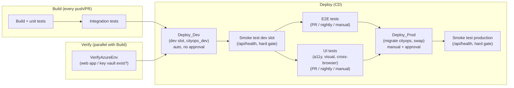

# CityOps — Deployment Guidelines

Provision Azure infrastructure and deploy CityOps from scratch, using Bicep (IaC) and Azure
DevOps YAML pipelines. Follow §1–§4 top to bottom on a clean subscription + a clean Azure DevOps
project to get a working dev + prod environment with gated CI/CD and no secrets in source
control — ending with the `infra-cicd` pipeline provisioning Azure and the `app-cicd` pipeline deploying
CityOps onto it.

---

## 1. Architecture overview

CityOps is a server-side Next.js app (App Router, NextAuth, Prisma) deployed to **Azure App Service** as **code** (no container), running the Next.js **standalone** output (`node server.js`).

### 1.1 One resource group, two logical environments

Dev and prod share a single resource group — separate resource groups would roughly double
infra cost for a project this size. Isolation is instead achieved **inside** each shared resource:

| Component     | Azure resource                                                                 | Isolation                                                                 |
| ------------- | ------------------------------------------------------------------------------ | ------------------------------------------------------------------------- |
| Web app       | One App Service (Linux, Node 24) + a **`dev` deployment slot**                 | Slot-sticky app settings (§6) point each slot at its own DB/secret        |
| Database      | One PostgreSQL Flexible Server, two databases: `cityops` (prod), `cityops_dev` | Separate databases — dev never touches prod data                          |
| Secrets       | One Key Vault (RBAC)                                                           | Separate secret names per env: `*-URL` / `*-URL-DEV`, `AUTH-SECRET(-DEV)` |
| AI validation | One Azure OpenAI account (`gpt-4o`)                                            | Shared — stateless                                                        |
| Identity      | System-assigned managed identity **per slot**                                  | Each slot's identity is granted Key Vault access independently            |

Full blast-radius isolation (separate resource groups) roughly doubles cost — see the note at the end of §7.2.

### 1.2 Deployment flow at a glance



---

## 2. Prerequisites

- Azure subscription with rights to create resources and role assignments (Owner, or Contributor + User Access Administrator)
- Azure CLI ≥ 2.60 with Bicep: `az bicep upgrade` (only needed if you want to lint/deploy locally — the pipelines don't need it on your machine)
- Azure DevOps organization + project, connected to this GitHub repository
- Permissions in that ADO project to create service connections, variable groups (Library), Environments, and pipelines

```bash
az login
az account set --subscription <SUBSCRIPTION_ID>
```

### Region

All resources default to **`francecentral`** (confirmed capacity for App Service slots,
PostgreSQL Flexible Server, and Azure OpenAI) via the independent `location`, `dbLocation`,
`openAiLocation` Bicep parameters — override any of them at pipeline-run time (via the
`cityops-env` variable group, §3.2) if a subscription lacks capacity there (see §9 for a
region-scan script).

> **Deployment slots require Standard (S1) or higher** — Free/Basic tiers don't support them, which is why `appServiceSkuName` defaults to `S1`.

---

## 3. One-time Azure DevOps setup

Everything below is a **one-time** setup per Azure DevOps project. Do these in order — each
step depends on the one before it. All of it can be done through the Azure DevOps web UI; CLI
equivalents (`az devops`/`az pipelines`) are given alongside for scripting or automation.

### 3.1 Create the ARM service connection

The pipelines need an identity to deploy to Azure. Create an **Azure Resource Manager** service
connection named **`cityops-azure-service-connection`** — this exact name is hardcoded in `.ado/app-cicd.yml` and
`.ado/infra-cicd.yml`'s `azureSubscription:` inputs (see §5.3 for why it can't come from a variable
group).

`infra/main.bicep` is **subscription-scoped** — it creates the resource group itself (there's no
`rg-cityops` to pre-create), so the service connection's underlying identity needs
**subscription-level** roles, not resource-group-level ones (you can't scope a role assignment
to a resource group that doesn't exist yet).

**UI:** Project Settings → Service connections → New service connection → Azure Resource
Manager → App registration (automatic) → Workload identity federation (recommended — no secret
to manage) → Scope level **Subscription** → select your subscription → Resource group:
**All resource groups** (leave unrestricted — the resource group is created by Bicep, not you)
→ name it `cityops-azure-service-connection` → Save.

**CLI equivalent:**

```bash
SP_JSON=$(az ad sp create-for-rbac --name cityops-azure-service-connection -o json)
SP_APP_ID=$(echo "$SP_JSON" | jq -r '.appId')
SUBSCRIPTION_ID=$(az account show --query id -o tsv)

az devops service-endpoint azurerm create \
  --name cityops-azure-service-connection \
  --azure-rm-service-principal-id "$SP_APP_ID" \
  --azure-rm-subscription-id "$SUBSCRIPTION_ID" \
  --azure-rm-subscription-name "$(az account show --query name -o tsv)" \
  --azure-rm-tenant-id "$(az account show --query tenantId -o tsv)"
```

Whichever path you use, the service principal needs **3 role assignments** at the
**subscription** scope — the automatic UI wizard and `az ad sp create-for-rbac` only grant
Contributor, so grant the other two explicitly:

- **Contributor** — create/update resources (granted automatically by the UI wizard / `az ad sp create-for-rbac`)
- **User Access Administrator** — Bicep grants Key Vault roles to each slot's managed identity, so the deploying principal must be able to grant roles too
- **Key Vault Secrets User** — the pipeline's own `AzureKeyVault@2` tasks (fetch dev/prod DB secret) run as this SP, not the App Service's managed identity; without this, every deploy fails with `403 Forbidden` on `getSecret` (Key Vault RBAC mode treats secret data-plane ops separately from Contributor)

**UI:** Subscription → **Access control (IAM)** → **+ Add** → **Add role assignment** → search
and select the role → **Next** → Members: **Select members** → search for the service
connection's app registration (its display name matches the service connection name,
`cityops-azure-service-connection`, unless you renamed it) → select it → **Review + assign**.
Repeat for all 3 roles (3 separate "Add role assignment" flows — you can only pick one role per
flow).

**CLI equivalent:** If you used the UI wizard to create the service connection, you won't have
`$SP_APP_ID` from an `az ad sp create-for-rbac` call — retrieve it from the connection itself
(works the same regardless of which path created it):

```bash
SC_ID=$(az devops service-endpoint list --query "[?name=='cityops-azure-service-connection'].id | [0]" -o tsv)
SP_APP_ID=$(az devops service-endpoint show --id "$SC_ID" --query "authorization.parameters.serviceprincipalid" -o tsv)
```

```bash
SCOPE="/subscriptions/$SUBSCRIPTION_ID"

az role assignment create --assignee "$SP_APP_ID" --role "Contributor" --scope "$SCOPE"
az role assignment create --assignee "$SP_APP_ID" --role "User Access Administrator" --scope "$SCOPE"
az role assignment create --assignee "$SP_APP_ID" --role "Key Vault Secrets User" --scope "$SCOPE"
```

> Git Bash on Windows mangles a leading `/subscriptions/...` argument into a Windows path — prefix `MSYS_NO_PATHCONV=1` before `az role assignment create` if you hit `MissingSubscription`.
>
> Assign at the **subscription** scope (`/subscriptions/$SUBSCRIPTION_ID`), not a resource
> group or individual resource — `infra/main.bicep` creates the resource group itself, so a
> narrower scope either doesn't exist yet at deploy time or silently excludes resources Bicep
> creates later (e.g. scoping `Key Vault Secrets User` to one Key Vault only works until that
> vault's name changes on a future deploy).

### 3.2 Create Library variable groups

Every environment-specific pipeline value lives in a Library variable group, never a YAML
literal (see §5.3 for details on why).

**`cityops-env`** (plain, non-secret — used by both pipelines):

**UI:** Pipelines → Library → + Variable group → name `cityops-env` → add the 5 variables below → toggle **Allow access to all pipelines** → Save.

**CLI equivalent:**

```bash
az pipelines variable-group create --name cityops-env --authorize true \
  --variables resourceGroup=rg-cityops \
              location=francecentral dbLocation=francecentral \
              baseName=cityops openAiAccountName=azopenai-cityops
```

**`cityops-infra`** (secret, provisioning-time — used by `infra.yml` only):

```bash
PGPASS="$(openssl rand -hex 20)Aa1"
AUTHSECRET="$(openssl rand -base64 32)"
AUTHSECRETDEV="$(openssl rand -base64 32)"

VG_ID=$(az pipelines variable-group create --name cityops-infra --authorize true \
  --variables placeholder=x --query id -o tsv)
az pipelines variable-group variable create --group-id "$VG_ID" --name pgAdminPassword --value "$PGPASS" --secret true
az pipelines variable-group variable create --group-id "$VG_ID" --name authSecret --value "$AUTHSECRET" --secret true
az pipelines variable-group variable create --group-id "$VG_ID" --name authSecretDev --value "$AUTHSECRETDEV" --secret true
az pipelines variable-group variable delete --group-id "$VG_ID" --name placeholder --yes
```

Store `PGPASS`/`AUTHSECRET`/`AUTHSECRETDEV` somewhere safe — rotating `pgAdminPassword` resets
the DB admin password; rotating an `authSecret*` invalidates sessions in that environment.

### 3.3 Create Environments (approval gates)

Two ADO Environments, shared by both pipelines:

- **`dev`** — no approval gate; deploys continuously on every push to `main`.
- **`prod`** — **Approval check**, 5-minute timeout, single required approver, "requester cannot approve their own run" enabled.

**UI:** Pipelines → **Environments** → New environment → name `dev` → Resource: None → Create.
Repeat for `prod`. Then on `prod`: **⋮** → **Approvals and checks** → **+ Add check** →
**Approvals** → add yourself (or a teammate) as approver → check **"The user requesting a
release or deployment should not approve it"** → timeout 5 minutes → Create.

### 3.4 Register the pipelines

Register both YAML pipelines already in this repo. Do **`infra-cicd` first** — the app pipeline
assumes the infrastructure it deploys to already exists.

**UI (repeat once per pipeline):** Pipelines → New pipeline → GitHub → authorize/select this
repository (`zynsys/cityops`) → **Existing Azure Pipelines YAML file** → branch `main`, path
`.ado/infra-cicd.yml` → Continue → click the dropdown next to **Run** → **Save** (don't run yet).
Repeat with path `.ado/app-cicd.yml`, naming it `app-cicd`.

**CLI equivalent** (needs a GitHub PAT with `repo` **and** `admin:repo_hook` scopes — the
`admin:repo_hook` scope is what lets Azure DevOps install the push/PR webhook on the repo, so CI
actually fires on push; a `repo`-only PAT registers the pipeline but never triggers it. Use
`az devops service-endpoint github create`, or reuse `gh auth token` if you're logged into the
GitHub CLI):

```bash
GITHUB_PAT=$(gh auth token --hostname github.com)
AZURE_DEVOPS_EXT_GITHUB_PAT="$GITHUB_PAT" az devops service-endpoint github create \
  --name cityops-github --github-url https://github.com/zynsys/cityops

GITHUB_SC_ID=$(az devops service-endpoint list --query "[?name=='cityops-github'].id | [0]" -o tsv)

az pipelines create --name infra-cicd --yml-path .ado/infra-cicd.yml \
  --repository zynsys/cityops --repository-type github --branch main \
  --service-connection "$GITHUB_SC_ID" --skip-first-run true

az pipelines create --name app-cicd --yml-path .ado/app-cicd.yml \
  --repository zynsys/cityops --repository-type github --branch main \
  --service-connection "$GITHUB_SC_ID" --skip-first-run true
```

By default the `cityops-azure-service-connection` service connection is **not** authorized for all pipelines
(least privilege — see §11.2). Authorize `infra-cicd` and `app-cicd` explicitly: Project Settings →
Service connections → `cityops-azure-service-connection` → Security → add both pipelines. (Or set **"Grant access
permission to all pipelines"** on the connection if you'd rather skip this per-pipeline step.)

---

## 4. Deploy end-to-end

With §3 done, you're ready to actually provision Azure and deploy the app.

### 4.1 Run the `infra-cicd` pipeline (provision Azure)

Pipelines → `infra-cicd` → **Run pipeline** → branch `main` → Run.

This runs **Validate** (Bicep lint + `what-if` preview) then, because it was triggered manually,
**Deploy** — gated by the `prod` approval you configured in §3.3. Approve it when prompted. The
`Deploy` stage runs `az deployment sub create` against `infra/main.bicep` (subscription-scoped —
it creates the resource group itself), provisioning:

- The resource group (if it doesn't already exist)
- App Service (Linux, Node 24) + `dev` deployment slot
- PostgreSQL Flexible Server with `cityops`/`cityops_dev` databases + PostGIS
- Key Vault (RBAC) with the DB/auth secrets, and RBAC grants to each slot's managed identity
- Azure OpenAI account + `gpt-4o` model deployment

Confirm it succeeded: Pipelines → `infra-cicd` → latest run → **Deploy** stage should be green, and
the published `infra-outputs` artifact contains `webAppName`, `webAppUrl`, `keyVaultName`, etc.

> A plain push to `main` that touches `infra/**` only runs **Validate** (the `what-if` diff) —
> `Deploy` never runs automatically. You must manually trigger a run to actually apply changes.

### 4.2 Run the `app-cicd` pipeline (build, test, deploy to dev)

A push to `main` (or a manual run) triggers `app-cicd` automatically: **Build & Unit tests** →
**Integration tests** → **Deploy_Dev** — no approval, deploys straight to the dev slot and
migrates `cityops_dev`.

Watch it: Pipelines → `app-cicd` → latest run. Once `Deploy_Dev` is green:

```bash
curl -I https://<webAppName>-dev.azurewebsites.net   # from the infra-outputs artifact
```

should return a real response from the CityOps app (not the empty-container placeholder you get
before any code has ever been deployed).

### 4.3 Promote to production

Production only ever deploys from a **manually-triggered** run of `app-cicd` (the one trigger where
`E2ETest` also runs in the same run, guaranteeing E2E passes before `Deploy_Prod` can):

Pipelines → `app-cicd` → **Run pipeline** → branch `main` → Run. Once `E2ETest` and `Deploy_Dev`
succeed, `Deploy_Prod` waits for the `prod` approval (§3.3) — approve it, and it migrates
`cityops` (prod DB) then **swaps** the dev slot into production (zero-downtime; rollback = swap
back).

```bash
curl -I https://<webAppName>.azurewebsites.net       # production, after the swap
```

---

## 5. Bicep reference (deep dive)

This section documents what the `infra-cicd` pipeline's `Deploy` stage actually runs (§4.1) — useful
for understanding or modifying the template, not a separate manual step.

The template is modularized — `infra/main.bicep` is a thin **subscription-scoped** orchestrator
that creates the resource group, then deploys everything else into it via a nested
resource-group-scoped module:

| File                                                                        | Owns                                                                                    |
| --------------------------------------------------------------------------- | --------------------------------------------------------------------------------------- |
| [`infra/main.bicep`](../infra/main.bicep)                                   | Subscription-scoped orchestrator: creates the resource group, invokes `resources.bicep` |
| [`infra/modules/resourcegroup.bicep`](../infra/modules/resourcegroup.bicep) | Creates (or adopts) the resource group                                                  |
| [`infra/modules/resources.bicep`](../infra/modules/resources.bicep)         | Resource-group-scoped orchestration: modules, Key Vault secrets, app settings, RBAC     |
| [`infra/modules/keyvault.bicep`](../infra/modules/keyvault.bicep)           | Key Vault (RBAC-enabled)                                                                |
| [`infra/modules/postgres.bicep`](../infra/modules/postgres.bicep)           | Flexible Server, `cityops`/`cityops_dev` DBs, PostGIS, firewall                         |
| [`infra/modules/appservice.bicep`](../infra/modules/appservice.bicep)       | Plan, Web App **+ `dev` deployment slot**                                               |
| [`infra/modules/openai.bicep`](../infra/modules/openai.bicep)               | Azure OpenAI account + `gpt-4o` model deployment                                        |

Resource names are derived deterministically from `baseName` alone (`app-<baseName>`, `kv-<baseName>`, `pg-<baseName>` — no random suffix), so re-running a deployment on the same resource group **adopts and updates** existing resources rather than creating duplicates. `app`/`kv`/`pg` names must be globally unique across all of Azure (not just this subscription), so `baseName` needs to be distinctive enough to avoid collisions — verified available for the default `cityops` via the `Microsoft.Web`/`Microsoft.KeyVault`/`Microsoft.DBforPostgreSQL` `checkNameAvailability` APIs. If you ever get a naming conflict on first deploy, change `baseName` to something more specific and redeploy.

Key parameters (set via the `cityops-env`/`cityops-infra` variable groups, §3.2):

| Parameter                                                         | Default                            | Purpose                                                                                     |
| ----------------------------------------------------------------- | ---------------------------------- | ------------------------------------------------------------------------------------------- |
| `resourceGroupName`                                               | `rg-cityops`                       | Name of the resource group to create (if missing) and deploy into                           |
| `baseName`                                                        | `cityops`                          | Base for every generated resource name (`app-<baseName>`, `kv-<baseName>`, `pg-<baseName>`) |
| `location` / `dbLocation` / `openAiLocation`                      | `francecentral`                    | Region per resource type                                                                    |
| `appServiceSkuName` / `appServiceSkuTier`                         | `S1` / `Standard`                  | App Service plan SKU                                                                        |
| `alwaysOn`                                                        | `true`                             | Keep the app warm (Standard+)                                                               |
| `openAiAccountName`                                               | `azopenai-cityops`                 | Azure OpenAI account name                                                                   |
| `openAiDeploymentName` / `openAiModelName` / `openAiModelVersion` | `gpt-4o` / `gpt-4o` / `2024-11-20` | Model deployment                                                                            |
| `openAiSkuName` / `openAiCapacity`                                | `GlobalStandard` / `100`           | Throughput (TPM), subject to quota                                                          |
| `pgAdminPassword`                                                 | _(secure)_                         | PostgreSQL admin password                                                                   |
| `authSecret` / `authSecretDev`                                    | _(secure)_                         | Prod / dev-slot `AUTH_SECRET`                                                               |

Bicep-generated resource **names** aren't stored anywhere beyond `baseName` — each deploy job in
`app.yml` computes the actual name at runtime purely by naming convention (deterministic, no
Azure query needed to find it), then does a single fast `az ... show` call per resource to verify
it exists and fail immediately if not (rather than letting a missing resource surface many minutes
later as an `AzureKeyVault@2`/`AzureWebApp@1` retry timeout):

```bash
webAppName="app-$(baseName)"
keyVaultName="kv-$(baseName)"
az webapp show -g "$(resourceGroup)" -n "$webAppName" -o none   # fails fast if missing
az keyvault show -n "$keyVaultName" -o none                    # fails fast if missing
```

If you ever need to deploy the template directly (bypassing the pipeline, e.g. for local testing):

```bash
RG=rg-cityops
az deployment sub create \
  --location francecentral -n cityops-infra \
  -f infra/main.bicep \
  -p resourceGroupName="$RG" location=francecentral dbLocation=francecentral \
     pgAdminPassword="$PGPASS" authSecret="$AUTHSECRET" authSecretDev="$AUTHSECRETDEV" \
  --query "properties.outputs" -o json
```

Outputs: `webAppName`, `webAppUrl`, `devSlotName`, `devSlotUrl`, `keyVaultName`, `postgresFqdn`, `resourceGroupName`.

### 5.3 Why the service connection name is a literal, not a variable

Every environment-specific value (`resourceGroup`, `baseName`, `location`, secrets) comes
from the `cityops-env`/`cityops-infra` variable groups — **except** the service connection name,
which is hardcoded as the literal string `'cityops-azure-service-connection'` in both `.ado/app-cicd.yml` and
`.ado/infra-cicd.yml`'s `azureSubscription:` inputs (it is deliberately NOT a `cityops-env` variable).
This isn't an oversight: Azure DevOps performs a
**static resource-authorization check** on `azureSubscription:` inputs at YAML-compile time, and
that check can't resolve a variable-group-sourced runtime macro like `$(azureServiceConnection)`
— it validates against the literal, unexpanded string and always reports "service connection
... could not be found," regardless of whether the connection is actually authorized. If you
rename the connection, update the literal in both YAML files (and re-authorize it per §3.4).

---

## 6. Application configuration (env vars) & secrets model

Runtime config mirrors [`.env.example`](../.env.example): non-secret values are App Service settings; secrets are **Key Vault references** resolved by each slot's managed identity.

| Variable                                            | Source in Azure                                                   |
| --------------------------------------------------- | ----------------------------------------------------------------- |
| `DATABASE_URL`                                      | Key Vault ref (`DATABASE-URL` / `-DEV`), slot-sticky              |
| `AUTH_SECRET`                                       | Key Vault ref (`AUTH-SECRET` / `-DEV`), slot-sticky               |
| `NEXTAUTH_URL`                                      | App setting per slot, slot-sticky                                 |
| `NODE_ENV`                                          | `production`                                                      |
| `STORAGE_PROVIDER`                                  | `azure` (uploads go to Blob Storage; `local` writes to disk)      |
| `AZURE_STORAGE_CONNECTION_STRING`                   | Key Vault ref (`AZURE-STORAGE-CONNECTION-STRING`), shared         |
| `AZURE_STORAGE_CONTAINER`                           | App setting per slot (`report-attachments` / `-dev`), slot-sticky |
| `AZURE_OPENAI_ENDPOINT` / `AZURE_OPENAI_DEPLOYMENT` | App setting, shared by both slots                                 |
| `AZURE_OPENAI_API_KEY`                              | Key Vault ref (`AZURE-OPENAI-API-KEY`), shared by both slots      |

Config is validated at startup by `validateEnv()` (`src/instrumentation.ts`) — a missing required variable fails fast.

### Secrets model — three tiers

| Tier                             | Used by             | Stored in                                  | Examples                                                                                             |
| -------------------------------- | ------------------- | ------------------------------------------ | ---------------------------------------------------------------------------------------------------- |
| **Provisioning-time**            | Infra pipeline only | `cityops-infra` variable group (secret)    | `pgAdminPassword`, `authSecret`, `authSecretDev`                                                     |
| **Runtime**                      | The running app     | Azure Key Vault, read via managed identity | `DATABASE-URL(-DEV)`, `AUTH-SECRET(-DEV)`, `AZURE-OPENAI-API-KEY`, `AZURE-STORAGE-CONNECTION-STRING` |
| **Pipeline config (non-secret)** | Both pipelines      | `cityops-env` variable group               | `resourceGroup`, `location`, `dbLocation`, `baseName`                                                |

No secret is ever a plaintext App Service setting or a pipeline YAML literal — always `@Microsoft.KeyVault(VaultName=...;SecretName=...)`, resolved via **Key Vault Secrets User** RBAC. `AZURE-OPENAI-API-KEY` is pulled from the OpenAI account with `listKeys()` inside Bicep, never exposed as an output.

---

## 7. Deployment flow (CI/CD) reference

### 7.1 App pipeline (`app-cicd`)

```
VerifyAzureEnv (web app / key vault exist?) ─┐
Build & Unit tests → Integration tests ──────┴→ Deploy_Dev (dev slot, migrate cityops_dev) [env: dev, no approval]
                                                 → Smoke test dev slot (/api/health, hard gate)
                                                ↘ E2E tests (PR / nightly / manual only)
                                                ↘ UI tests: a11y, visual, cross-browser (PR / nightly / manual only)

Manual run only: ... → E2E tests + UI tests (both pass) → Deploy_Prod (migrate cityops, swap dev→prod) [env: prod, approval]
                                                             → Smoke test production (/api/health, hard gate)
```

- **VerifyAzureEnv** runs in parallel with Build & Unit tests (no dependency between them) so a
  missing Azure environment (infra not deployed yet, or deployed under a different
  `baseName`/`resourceGroup`) fails within seconds — a single non-retrying `az webapp show`/
  `az keyvault show` per resource — instead of surfacing minutes later inside a deploy step's own
  retry/backoff logic. `Deploy_Dev` depends on it directly; `Deploy_Prod` depends on `Deploy_Dev`,
  so it's covered transitively.
- **Smoke test** (§11.7) runs immediately after each deploy step (dev-slot deploy, prod swap) —
  curls `/api/health` with retries (covers cold start) and hard-fails if it never returns 200, so a
  broken deploy is caught by the pipeline instead of discovered by a user.
- **UI tests** (§11.8) run in parallel with E2E tests (same trigger condition) — accessibility,
  visual regression, and cross-browser/responsive checks, kept as a separate stage from E2E
  because a visual diff often means "approve a new baseline", not "the app is broken".
- **Build** produces an environment-agnostic standalone artifact (`drop`) — no runtime config needed.
- **Deploy_Dev** auto-deploys to the dev slot + migrates `cityops_dev` on every push to `main`, no approval.
- **E2E tests** run on PRs, nightly, and manual runs only — not on every push, to keep dev-deploy fast.
- **Deploy_Prod** only runs on a manually-triggered run (the one trigger where E2E also runs), depends on `Deploy_Dev` + `E2ETest`, migrates `cityops`, then **swaps** dev → production. Gated by the `prod` approval — there is no automatic path to production.

### 7.2 Infra pipeline (`infra-cicd`)

```
Validate (bicep lint + what-if, every push/PR) → Deploy (manual run only) [env: prod, approval]
```

`what-if` runs automatically on every push/PR — read the diff before applying. `Deploy` only runs on a manual pipeline run, gated by the same `prod` approval.

> Infra provisions **shared** resources in one apply (one Key Vault, one Postgres server, one plan for both slots), so there's no separate "dev infra" to test first the way the app tests in the dev slot before promoting — the automatic `what-if` diff plus the manual-run + approval gate is the equivalent safeguard. Full dev/prod infra isolation (separate resource groups) would enable that, but roughly doubles cost and retires the slot-swap design (§1.1) — not implemented by default.

---

## 8. Manual operations

```bash
# Run migrations
DATABASE_URL="<cityops_dev connection string>" npm run db:migrate:deploy   # dev
DATABASE_URL="<cityops connection string>" npm run db:migrate:deploy       # prod

# Seed data (non-production only)
DATABASE_URL="<cityops_dev connection string>" npm run db:seed

# Roll back production (previous build is still in the dev slot after a swap)
az webapp deployment slot swap -g rg-cityops -n <WEB_APP_NAME> --slot dev --target-slot production

# Verify
curl -I https://<WEB_APP_NAME>.azurewebsites.net          # production
curl -I https://<WEB_APP_NAME>-dev.azurewebsites.net       # dev slot
```

---

## 9. Troubleshooting

| Symptom                                                                                 | Cause / Fix                                                                                                                                                                                                                                                                                                                                                                                                                                                                                                                                                                                                                                                                                                                         |
| --------------------------------------------------------------------------------------- | ----------------------------------------------------------------------------------------------------------------------------------------------------------------------------------------------------------------------------------------------------------------------------------------------------------------------------------------------------------------------------------------------------------------------------------------------------------------------------------------------------------------------------------------------------------------------------------------------------------------------------------------------------------------------------------------------------------------------------------- |
| `SubscriptionIsOverQuotaForSku … Total VMs: 0`                                          | No App Service quota in that region — try another region or request an increase. Slots need S1+.                                                                                                                                                                                                                                                                                                                                                                                                                                                                                                                                                                                                                                    |
| PostgreSQL `Version should be in: []`                                                   | Flexible Server SKU not offered in that region — change `dbLocation`.                                                                                                                                                                                                                                                                                                                                                                                                                                                                                                                                                                                                                                                               |
| `NetworkAcls is required for this resouce` (Azure OpenAI)                               | Set `networkAcls.defaultAction` explicitly in the module.                                                                                                                                                                                                                                                                                                                                                                                                                                                                                                                                                                                                                                                                           |
| Missing `server.js` / standalone output not found                                       | `output: 'standalone'` must be set in [`next.config.ts`](../next.config.ts).                                                                                                                                                                                                                                                                                                                                                                                                                                                                                                                                                                                                                                                        |
| Migration can't reach the DB from the agent                                             | Ensure the "Allow Azure services" firewall rule exists, or add the agent IP.                                                                                                                                                                                                                                                                                                                                                                                                                                                                                                                                                                                                                                                        |
| Key Vault reference unresolved (app can't read a secret at runtime)                     | Confirm **Key Vault Secrets User** is granted to that specific slot's managed identity (Bicep does this — check the RBAC blade if it's missing).                                                                                                                                                                                                                                                                                                                                                                                                                                                                                                                                                                                    |
| Pipeline's `AzureKeyVault@2` task fails with `403 Forbidden` on `getSecret`             | The service connection's SP itself needs **Key Vault Secrets User** at the resource group scope (§3.1) — separate from the slot's managed identity.                                                                                                                                                                                                                                                                                                                                                                                                                                                                                                                                                                                 |
| `azureSubscription: '$(azureServiceConnection)'` fails validation: "could not be found" | This pattern must never be used — ADO can't statically resolve a variable-group macro for this input, only the literal connection name (see §5.3). There is no `azureServiceConnection` variable in `cityops-env` (removed as unused/misleading).                                                                                                                                                                                                                                                                                                                                                                                                                                                                                   |
| App/infra pipeline doesn't run on push to `main` (no CI)                                | GitHub-sourced pipeline: the repo's Azure DevOps **webhook** is missing or failing delivery. Usually the GitHub PAT behind the `cityops-github` service connection lacks **`admin:repo_hook`** (or the PAT expired), so no webhook was ever installed. Fix the PAT scopes (`repo` + `admin:repo_hook`), recreate the connection, then re-save the pipeline. Also confirm the pipeline's **Edit → ⋮ → Triggers** UI does **not** have "Override the YAML continuous integration trigger" enabled, and that the pipeline isn't paused/disabled. Note: `.ado/app-cicd.yml` has no path filter so any push to `main` triggers it; `.ado/infra-cicd.yml` only triggers on `infra/**` + `.ado/infra-cicd.yml` changes — that's by design. |
| App/Key Vault not found under the computed `app-<baseName>`/`kv-<baseName>` name        | Infra not deployed yet, or `baseName`/`resourceGroup` in `cityops-env` don't match what infra actually deployed. Run the `infra-cicd` pipeline first (§4.1).                                                                                                                                                                                                                                                                                                                                                                                                                                                                                                                                                                        |
| `az devops invoke` errors `could not convert string to float`                           | Use the bare preview API version (e.g. `7.2-preview`, no `.N` suffix).                                                                                                                                                                                                                                                                                                                                                                                                                                                                                                                                                                                                                                                              |
| `az devops invoke` GET ignores `resourceType`/`resourceId`                              | Pass them via `--query-parameters`, not `--route-parameters`.                                                                                                                                                                                                                                                                                                                                                                                                                                                                                                                                                                                                                                                                       |
| `az devops invoke` JSON output fails to parse (`Expecting value`)                       | CLI sometimes prints a status line before the JSON — strip the first line or parse stdout/stderr separately.                                                                                                                                                                                                                                                                                                                                                                                                                                                                                                                                                                                                                        |
| `az rest` against `hp-gmail-org`-style (MSA-backed) orgs returns an HTML sign-in page   | AAD resource-token auth isn't accepted the way the `az devops`/`az pipelines` extension's own auth flow is — use `az devops`/`az pipelines` commands instead of raw `az rest` where possible.                                                                                                                                                                                                                                                                                                                                                                                                                                                                                                                                       |
| ARM Template Deployment fails: `403 Failed to check the resource group status`          | SP has no RBAC on the target resource group — grant it (§3.1).                                                                                                                                                                                                                                                                                                                                                                                                                                                                                                                                                                                                                                                                      |
| ARM deployment fails: `ResourceNotFound` for a resource the template itself creates     | An `existing`-typed lookup (e.g. `openAiRef`, `keyVaultRef`) is racing the module that creates it — add an explicit `dependsOn` on the lookup.                                                                                                                                                                                                                                                                                                                                                                                                                                                                                                                                                                                      |
| `az role assignment create --scope /subscriptions/...` fails with `MissingSubscription` | Git Bash mangles the path — prefix `MSYS_NO_PATHCONV=1`.                                                                                                                                                                                                                                                                                                                                                                                                                                                                                                                                                                                                                                                                            |
| Key Vault/Cognitive Services deployment fails: resource "has been soft-deleted"         | A same-named resource was deleted recently and Azure retains it for a retention period — `az keyvault purge` / `az cognitiveservices account purge`, or pick a different name.                                                                                                                                                                                                                                                                                                                                                                                                                                                                                                                                                      |

### Find a region with capacity

```bash
for r in francecentral ukwest westeurope northeurope; do
  echo "== $r =="
  az deployment sub what-if --location "$r" -f infra/main.bicep -n quotacheck \
    -p resourceGroupName=rg-cityops location=$r dbLocation=$r \
       pgAdminPassword="Throwaway$(openssl rand -hex 8)Aa1" \
       authSecret="throwaway-validate-secret-0123456789abcd" \
       authSecretDev="throwaway-validate-secret-dev-0123456789ab" \
    2>&1 | grep -iE "quota|SubscriptionIsOver" || echo "OK (no quota error)"
done
```

---

## 10. Cost & teardown

- **S1 Standard** ≈ $70/month (required for slots). Downgrade to F1 to pause costs (removes the dev slot — F1 doesn't support slots):

  ```bash
  az appservice plan update -g rg-cityops -n asp-cityops --sku F1
  ```

- Full teardown (irreversible — deletes everything in the resource group, incl. `azopenai-cityops`):

  ```bash
  az group delete -n rg-cityops --yes --no-wait
  ```

Delete individual resources instead of the whole group if `rg-cityops` contains anything you need to keep.

---

## 11. Additional hardening & best practices

§1–§10 cover the core requirements. This section covers extra hardening that's standard practice but easy to miss.

### 11.1 GitHub repository connection & branch protection

The repo lives on **GitHub**, not Azure Repos, so two things that don't show up anywhere else
in this document need setting up:

- **GitHub service connection** — needed so pipelines can trigger on GitHub push/PR (§3.4 creates one via `gh auth token`, or a PAT with `repo` scope). Otherwise: Project Settings → Service connections → New → **GitHub**.
- **Branch protection on `main`** — this is a GitHub setting (ADO branch policies don't apply to a GitHub-hosted repo):

  ```bash
  gh api repos/zynsys/cityops/branches/main/protection -X PUT --input - <<'EOF'
  {
    "required_status_checks": { "strict": true, "contexts": ["app"] },
    "enforce_admins": true,
    "required_pull_request_reviews": { "required_approving_review_count": 1 },
    "restrictions": null
  }
  EOF
  ```

### 11.2 Environment hardening beyond the approval check

- **Requester cannot approve their own run** — already enabled in §3.3 (separation of duties).
- **Branch control check** — restricts `prod` deploys to `main` only: Environments → `prod` → Approvals and checks → **Branch control** → `refs/heads/main`.
- **Exclusive lock check** — serializes concurrent `prod` deploys: Approvals and checks → **Exclusive lock**. YAML side already set: `Deploy_Prod`/`Deploy` set `lockBehavior: sequential`.
- **Least-privilege service connection** — leave `cityops-azure-service-connection` NOT authorized for all pipelines by default; explicitly authorize `app-cicd`/`infra-cicd` under Service connections → `cityops-azure-service-connection` → Security (§3.4).

### 11.3 Pipeline hygiene

- **Lint** and **`npm audit --audit-level=high`** run in `Build_and_UnitTest` as **warn-only** — the repo has 9 pre-existing lint errors; fix those, then make it blocking.
- **Code metrics** (also `Build_and_UnitTest`, also warn-only):
  - **Cyclomatic complexity** — ESLint's built-in `complexity` rule (`eslint.config.mjs`, threshold 15), no new dependency or pipeline step — rides on the existing lint step. 16 pre-existing findings as of introduction.
  - **Code duplication** — [`jscpd`](https://github.com/kucherenko/jscpd) scans `src/` (`npm run check:duplication`, 5% threshold); HTML report published as the `jscpd-report`/`jscpd-report` pipeline artifact. ~5.9% duplicated lines as of introduction.
  - **Bundle size** — [`size-limit`](https://github.com/ai/size-limit) + `@size-limit/file` (`npm run check:bundle-size`) checks the built `.next/static/chunks` brotli-compressed size against an 800 kB budget in `package.json`'s `size-limit` key (measured ~475 kB at introduction — this is a fixed budget, not historical trend tracking). Runs after `npm run build`.
- **Shared resolve-names template** — [`.ado/templates/resolve-azure-names.yml`](../.ado/templates/resolve-azure-names.yml), used by both `Deploy_Dev` and `Deploy_Prod`. Names are computed deterministically (no uniqueString suffix) — a plain string computation, no Azure CLI needed here, because existence is already verified upstream by the dedicated `VerifyAzureEnv` stage ([`.ado/templates/verify-azure-resources.yml`](../.ado/templates/verify-azure-resources.yml)), which runs a fast, non-retrying `az webapp show`/`az keyvault show` in parallel with `Build_and_UnitTest` and fails the pipeline within seconds — as its own clearly-named stage — if the target environment doesn't exist yet.
- **Nightly drift detection** — `infra.yml`'s `Validate` stage also runs on a nightly schedule; `Deploy` stays manual-gated, so nothing auto-applies.

### 11.4 Retention & cost governance

- **Retention** — set once: Project Settings → Pipelines → Settings → **Retention** (not scriptable via a verified REST endpoint).
- **Resource tagging** — every resource in `infra/main.bicep` carries a `tags` object (default `{ project: 'cityops', managedBy: 'bicep' }`, overridable) for cost allocation.

### 11.5 Azure Policy compliance stage (infra pipeline)

An Azure Policy is **assigned to the resource group** (codified in Bicep), and `infra.yml` has a
dedicated **`PolicyCompliance`** stage — between `Validate` and `Deploy` — that reads that
compliance state and fails if any resource is non-compliant, so infra is never (re-)applied on top
of a drifted environment (e.g. a tag removed manually, outside Bicep). Governance lives here rather
than in the app pipeline because the app pipeline never creates or modifies Azure resources — it
only deploys code onto infrastructure that already exists.

- **The policy** — `cityops-require-tags` (custom definition, subscription-scoped, in [`infra/modules/policy-definitions.bicep`](../infra/modules/policy-definitions.bicep)) flags any resource missing the `requiredTagName` tag. Assigned to the RG by [`infra/modules/policy.bicep`](../infra/modules/policy.bicep) (wired via `resources.bicep`) on every `az deployment` — no manual `az policy assignment create`.
- **The stage** — [`.ado/templates/azure-policy-compliance.yml`](../.ado/templates/azure-policy-compliance.yml) runs `az policy state summarize -g <rg>` and fails if `nonCompliantResources > 0` (with `triggerScan: true` for a fresh evaluation). It runs on the same triggers as `Validate` (push/PR/nightly) for continuous drift visibility, and `Deploy` (manual-gated) `dependsOn` it — so an apply is blocked, not just flagged. The built-in `AzurePolicyCheckGate@0` task is Classic-release-only, hence the CLI approach.
- **Effect must be `Audit`** — `requireTagsEffect` defaults to **`Audit`** (not `Deny`) precisely so the stage is the enforcement point. With `Deny`, Azure would reject a tag-removal update itself, so drift could never be created (or demoed) in the first place. `requiredTagName` defaults to **`project`** (Bicep applies it, so resources start compliant).
- **RBAC** — the stage needs `Microsoft.PolicyInsights/policyStates/*/read` + `.../triggerEvaluation/action` (covered by the SP's **Contributor**); creating the assignment needs `Microsoft.Authorization/policyAssignments/write` (covered by **User Access Administrator**). No managed identity needed for Audit.

#### 11.5.1 Demo: the stage blocks an apply on a policy violation

1. **Baseline** — infra has run, so every resource carries the `project` tag and `cityops-require-tags` (Audit) is assigned. Resources are compliant.
2. **Break compliance** — remove the `project` tag from a **top-level** resource (e.g. the Key Vault or the web app — not a slot):

   ```bash
   MSYS_NO_PATHCONV=1 az resource tag --ids \
     $(az webapp show -g rg-cityops -n app-cityops --query id -o tsv) \
     --tags managedBy=bicep   # 'project' intentionally omitted
   ```

3. **Run the infra pipeline** — `Validate` passes, then `PolicyCompliance` triggers a fresh scan, sees `nonCompliantResources ≥ 1`, logs the offending resource + policy, and **fails before `Deploy`** — the apply is blocked.
4. **Restore** — re-add `project=cityops` and rerun → the stage passes and `Deploy` proceeds (on a manual run).

> **Timing note.** Compliance state is evaluated **asynchronously** by Azure. `triggerScan: true` forces a fresh evaluation each run, but a brand-new assignment can still take a few minutes to produce its first results. Give the assignment a few minutes after the first infra deploy before running the remove-tag demo, and always change the tag on a **top-level** resource (deployment slots are child resources and aren't reliably counted).

### 11.6 Cost estimate stage

`CostEstimate` runs in parallel with `PolicyCompliance` (both `dependsOn: Validate`) and is purely
informational — it never fails the pipeline. It queries the public [Azure Retail Prices API](https://learn.microsoft.com/en-us/rest/api/cost-management/retail-prices/azure-retail-prices)
(no auth required) for the three **fixed-capacity** resources this template provisions and prints a
monthly estimate:

- App Service Plan (`$(location)`, SKU from the `appServiceSku` stage variable — keep in sync with `appServiceSkuName`'s default in `main.bicep`)
- PostgreSQL Flexible Server compute (`$(dbLocation)`, SKU from `pgComputeSku` — keep in sync with the `sku.name` in `postgres.bicep`)
- PostgreSQL storage (`pgStorageGb` — keep in sync with `storageSizeGB` in `postgres.bicep`)

**Deliberately excluded** (usage-based, no fixed monthly rate — a flat number would be misleading):
Azure OpenAI (`GlobalStandard` bills per-token, not per-capacity), Application Insights / Log
Analytics (per-GB ingested), Key Vault (per-operation). The stage calls this out explicitly rather
than guessing a number.

If the Retail Prices API filter doesn't match a meter (e.g. a SKU/region combination that isn't
sold), the stage logs a `##vso[task.logissue type=warning]` and reports the incomplete estimate
rather than failing — the estimate is advisory, not a gate.

### 11.7 Post-deploy smoke tests (infra-level and app-level)

Two distinct smoke tests exist, at two different layers — one per pipeline:

**Infra-level** (`infra.yml`'s `SmokeTest` stage) — verifies the _resources_ just (re-)provisioned
are healthy, not just that ARM reported success:

- **Hard-blocking checks** (fail the stage): Key Vault, PostgreSQL Flexible Server, and Azure OpenAI
  provisioning/ready state, read via `az keyvault show` / `az postgres flexible-server show` /
  `az cognitiveservices account show`. These are always expected healthy immediately after a
  successful apply, regardless of whether any app code has been deployed.
- **Informational only** (logs a warning, does not fail): HTTP reachability of the production and
  dev-slot web app URLs. On the **very first** infra deploy there is no app code yet — the app
  pipeline deploys that separately — so a non-200 response is normal until `app.yml` has run at
  least once. Treating this as a hard gate would break first-time bootstrap.
- Resource identifiers are read from the `infra-outputs` artifact published by `Deploy`
  (`webAppUrl`, `devSlotUrl`, `keyVaultName`, `postgresServerName` — the last exposed as a Bicep
  output specifically to avoid parsing it out of the FQDN).

**App-level** (`app.yml` — a step after each deploy, not a separate stage) — verifies the _code_
just deployed is actually serving traffic:

- Target: `GET /api/health` ([`src/app/api/health/route.ts`](../src/app/api/health/route.ts)) — a
  cheap route that does a `SELECT 1` through Prisma and returns `200`/`{"status":"ok"}`, or
  `503`/`{"status":"error"}` if the DB round-trip fails.
- Runs right after **Deploy_Dev**'s slot deploy (against the dev-slot URL) and right after
  **Deploy_Prod**'s swap (against the production URL) — [`.ado/templates/smoke-test.yml`](../.ado/templates/smoke-test.yml)
  / [`.github/actions/smoke-test`](../.github/actions/smoke-test/action.yml). Curls with retries
  (10 attempts, 6s apart, to ride out cold start) and **hard-fails** the deploy if it never returns
  200 — unlike the infra-level check, by this point the code is genuinely expected to be serving.
- **`healthCheckPath: '/api/health'`** is also wired into both the production site and dev slot in
  [`infra/modules/appservice.bicep`](../infra/modules/appservice.bicep) — this is Azure App
  Service's own platform-level health check (evicts unhealthy instances from rotation), separate
  from and complementary to the pipeline step above.

#### 11.7.1 Further pipeline ideas (not yet implemented)

- **IaC static analysis** — [PSRule for Azure](https://azure.github.io/PSRule.Rules.Azure/) or [Checkov](https://www.checkov.io/) scanning `infra/**` for security/best-practice issues (e.g. public network access, missing diagnostic settings) as part of `Validate`, catching problems before `what-if` even runs.

### 11.8 UI tests (accessibility, visual regression, cross-browser)

`UITest` (ADO stage) / `ui_test` (GH job) runs **in parallel with `E2ETest`**/`e2e_test` (same
`dependsOn`/`needs`, same trigger condition — PR, nightly, manual only, never on every push) but is
a **separate** stage/job because its checks have different failure semantics than the functional
E2E gate: a visual diff often means "the UI changed on purpose, go approve a new baseline", not
"the app is broken" — mixing that into the hard functional gate would make routine UI changes look
like regressions. `Deploy_Prod` depends on it too, same as `E2ETest`.

Three concerns, one Playwright config ([`playwright.config.ts`](../playwright.config.ts)), split by
**project** (selected via `--project`, not by adding new npm scripts per concern):

| Project                            | Specs                                         | Purpose                                                                                                                                                |
| ---------------------------------- | --------------------------------------------- | ------------------------------------------------------------------------------------------------------------------------------------------------------ |
| `chromium`                         | `auth`/`home`/`reports.spec.ts`               | The existing functional E2E suite — used by `test:e2e` only                                                                                            |
| `firefox`/`webkit`/`mobile-chrome` | same functional specs                         | Cross-browser/responsive — same assertions, different engines/viewport                                                                                 |
| `a11y`                             | [`e2e/a11y.spec.ts`](../e2e/a11y.spec.ts)     | [`@axe-core/playwright`](https://www.npmjs.com/package/@axe-core/playwright) scan of `/`, `/reports`, `/sign-in`, `/register` — fails on any violation |
| `visual`                           | [`e2e/visual.spec.ts`](../e2e/visual.spec.ts) | `toHaveScreenshot()` full-page diff of the same key pages                                                                                              |

`npm run test:e2e` runs `--project=chromium` only — **unchanged behavior**, so the existing fast
dev-deploy gate isn't slowed down by this addition. `npm run test:ui` runs the other five projects.

**Visual baseline gotcha:** screenshots are sensitive to OS/font rendering — a baseline generated
on a local Windows/macOS machine will mismatch against the `ubuntu-latest` CI agents. Baselines
must be generated by CI itself. To (re)generate them: temporarily add `--update-snapshots` to the
`ui_test`/`UITest` step's `npm run test:ui` invocation, run the pipeline once, download the
`ui-test-report` artifact (or the `e2e/visual.spec.ts-snapshots/` folder it writes to the
workspace), commit those PNGs, then remove the flag again. A first-ever run (or a run against a
brand-new/changed page) failing with "no baseline found" is expected, not a bug.

---

## 12. Reference files

<!-- markdownlint-disable MD060 -->

| File                                                                                          | Purpose                                                           |
| --------------------------------------------------------------------------------------------- | ----------------------------------------------------------------- |
| [`infra/main.bicep`](../infra/main.bicep)                                                     | Subscription-scoped infrastructure orchestrator                   |
| [`infra/modules/resourcegroup.bicep`](../infra/modules/resourcegroup.bicep)                   | Creates (or adopts) the resource group                            |
| [`infra/modules/resources.bicep`](../infra/modules/resources.bicep)                           | Resource-group-scoped orchestrator (modules, secrets, RBAC)       |
| [`infra/modules/keyvault.bicep`](../infra/modules/keyvault.bicep)                             | Key Vault module                                                  |
| [`infra/modules/postgres.bicep`](../infra/modules/postgres.bicep)                             | PostgreSQL Flexible Server module                                 |
| [`infra/modules/appservice.bicep`](../infra/modules/appservice.bicep)                         | App Service (plan + web app + dev slot) module                    |
| [`infra/modules/openai.bicep`](../infra/modules/openai.bicep)                                 | Azure OpenAI account + model deployment module                    |
| [`infra/modules/policy.bicep`](../infra/modules/policy.bicep)                                 | Azure Policy assignments applied to the resource group (§11.5)    |
| [`infra/modules/policy-definitions.bicep`](../infra/modules/policy-definitions.bicep)         | Custom Azure Policy definitions (subscription scope, §11.5)       |
| [`.ado/app-cicd.yml`](../.ado/app-cicd.yml)                                                   | App CI/CD (verify env, build, test, deploy dev/prod)              |
| [`.ado/infra-cicd.yml`](../.ado/infra-cicd.yml)                                               | Infra pipeline (validate + apply)                                 |
| [`.ado/templates/verify-azure-resources.yml`](../.ado/templates/verify-azure-resources.yml)   | `VerifyAzureEnv` stage: fail-fast existence check (§11.3)         |
| [`.ado/templates/resolve-azure-names.yml`](../.ado/templates/resolve-azure-names.yml)         | Shared web app / Key Vault name computation step (§11.3)          |
| [`.ado/templates/smoke-test.yml`](../.ado/templates/smoke-test.yml)                           | App-level post-deploy smoke test step (§11.7)                     |
| [`.ado/templates/setup-nodejs.yml`](../.ado/templates/setup-nodejs.yml)                       | Shared Node.js install + `npm ci` step                            |
| [`.ado/templates/azure-policy-compliance.yml`](../.ado/templates/azure-policy-compliance.yml) | Infra-pipeline Azure Policy compliance stage (§11.5)              |
| [`src/app/api/health/route.ts`](../src/app/api/health/route.ts)                               | Smoke-test target: liveness + DB round-trip (§11.7)               |
| [`e2e/a11y.spec.ts`](../e2e/a11y.spec.ts)                                                     | Accessibility scan (axe-core), part of `UITest`/`ui_test` (§11.8) |
| [`e2e/visual.spec.ts`](../e2e/visual.spec.ts)                                                 | Visual regression screenshots, part of `UITest`/`ui_test` (§11.8) |
| [`eslint.config.mjs`](../eslint.config.mjs)                                                   | Lint rules, incl. `complexity` code metric (§11.3)                |
| [`.env.example`](../.env.example)                                                             | Full list of runtime environment variables                        |
| [`Dockerfile`](../Dockerfile)                                                                 | Optional container build (not used for App Service code deploy)   |

<!-- markdownlint-enable MD060 -->
