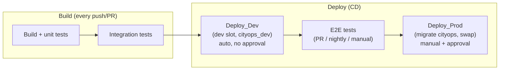

# CityOps — Deployment Guidelines

Provision Azure infrastructure and deploy CityOps from scratch, using Bicep (IaC) and Azure
DevOps pipelines. Follow §1–§5 to reproduce the environment on a clean subscription + a clean
Azure DevOps project: a working dev + prod environment, gated CI/CD, no secrets in source control.

---

## 1. Architecture overview

CityOps is a server-side Next.js app (App Router, NextAuth, Prisma) deployed to **Azure App Service** as **code** (no container), running the Next.js **standalone** output (`node server.js`).

### 1.1 One resource group, two logical environments

Dev and prod share a single resource group — separate resource groups would roughly double
infra cost for a project this size. Isolation is instead achieved **inside** each shared resource:

| Component     | Azure resource                                                                 | Isolation                                                                 |
| ------------- | ------------------------------------------------------------------------------ | ------------------------------------------------------------------------- |
| Web app       | One App Service (Linux, Node 24) + a **`dev` deployment slot**                 | Slot-sticky app settings (§6) point each slot at its own DB/secret        |
| Database      | One PostgreSQL Flexible Server, two databases: `cityops` (prod), `cityops_dev` | Separate databases — dev never touches prod data                          |
| Secrets       | One Key Vault (RBAC)                                                           | Separate secret names per env: `*-URL` / `*-URL-DEV`, `AUTH-SECRET(-DEV)` |
| AI validation | One Azure OpenAI account (`gpt-4o`)                                            | Shared — stateless                                                        |
| Identity      | System-assigned managed identity **per slot**                                  | Each slot's identity is granted Key Vault access independently            |

Full blast-radius isolation (separate resource groups) roughly doubles cost — see the note at the end of §7.2.

### 1.2 Deployment flow at a glance



---

## 2. Prerequisites

- Azure subscription with rights to create resources and role assignments (Owner, or Contributor + User Access Administrator)
- Azure CLI ≥ 2.60 with Bicep: `az bicep upgrade`
- Node.js 20+ and npm
- Azure DevOps organization + project, connected to this GitHub repository

```bash
az login
az account set --subscription <SUBSCRIPTION_ID>
```

### Region

All resources default to **`francecentral`** (confirmed capacity for App Service slots,
PostgreSQL Flexible Server, and Azure OpenAI) via the independent `location`, `dbLocation`,
`openAiLocation` parameters — override any of them if a subscription lacks capacity there (see
§9 for a region-scan script).

> **Deployment slots require Standard (S1) or higher** — Free/Basic tiers don't support them, which is why `appServiceSkuName` defaults to `S1`.

---

## 3. Quick start — automated setup

[`scripts/setup.sh`](../scripts/setup.sh) provisions the resource group, deploys Bicep, creates
the ARM service connection, both Library variable groups, the `dev`/`prod` Environments, and
registers the 2 YAML pipelines (`infra`, `app`).

```bash
./scripts/setup.sh
```

It's interactive by default — prompts for each value below with a sensible default (current
`az account` subscription, an already-configured `az devops` org/project, etc.); press Enter to
accept or type a new value: `AZURE_SUBSCRIPTION_ID`, `BASE_NAME` (prefix for every generated
resource name — §4), `RESOURCE_GROUP` (defaults to `rg-<BASE_NAME>-<hash>`, same deterministic
hash convention as the resources inside it), `OPENAI_ACCOUNT_NAME`, `LOCATION`, `DB_LOCATION`,
`ADO_ORG_URL`, `ADO_PROJECT`, `SERVICE_CONNECTION_NAME`, `SP_SCOPE` (§5.1),
`AUTHORIZE_FOR_ALL_PIPELINES` (§11.2), `GITHUB_REPO_URL`, `GITHUB_PAT` (§11.1, hidden input).
Leaving `ADO_ORG_URL` blank skips Azure DevOps entirely (Azure infra only). Pre-set any of these
as environment variables to change the default shown, or run non-interactively (e.g. in CI) to
skip all prompts:

```bash
AZURE_SUBSCRIPTION_ID=<subscription-id> ADO_ORG_URL=https://dev.azure.com/<org> ADO_PROJECT=<project> \
  ./scripts/setup.sh </dev/null
```

`PG_ADMIN_PASSWORD`, `AUTH_SECRET`, `AUTH_SECRET_DEV` are auto-generated if omitted (not
prompted for). Safe to re-run — every step checks for an existing target first.

**Not automated** (need interactive Graph lookups, have no YAML/ARM form, or shouldn't be
changed silently by a script): the `prod` approval's approver, Branch control / Exclusive lock
checks, GitHub branch protection — see §5.2, §11.

---

## 4. Provision infrastructure with Bicep (deep dive)

The template is modularized — `infra/main.bicep` orchestrates one module per logical concern:

| File                                                                  | Owns                                                            |
| --------------------------------------------------------------------- | --------------------------------------------------------------- |
| [`infra/main.bicep`](../infra/main.bicep)                             | Orchestration: modules, Key Vault secrets, app settings, RBAC   |
| [`infra/modules/keyvault.bicep`](../infra/modules/keyvault.bicep)     | Key Vault (RBAC-enabled)                                        |
| [`infra/modules/postgres.bicep`](../infra/modules/postgres.bicep)     | Flexible Server, `cityops`/`cityops_dev` DBs, PostGIS, firewall |
| [`infra/modules/appservice.bicep`](../infra/modules/appservice.bicep) | Plan, Web App **+ `dev` deployment slot**                       |
| [`infra/modules/openai.bicep`](../infra/modules/openai.bicep)         | Azure OpenAI account + `gpt-4o` model deployment                |

Resource names are derived deterministically (`uniqueString(resourceGroup().id)`), so re-running a deployment on the same resource group **adopts and updates** existing resources rather than creating duplicates.

Key parameters:

| Parameter                                                         | Default                            | Purpose                                                                                                                     |
| ----------------------------------------------------------------- | ---------------------------------- | --------------------------------------------------------------------------------------------------------------------------- |
| `baseName`                                                        | `cityops`                          | Prefix for every generated resource name (`app-<baseName>-<hash>`, etc.)                                                    |
| `location` / `dbLocation` / `openAiLocation`                      | `francecentral`                    | Region per resource type                                                                                                    |
| `appServiceSkuName` / `appServiceSkuTier`                         | `S1` / `Standard`                  | App Service plan SKU                                                                                                        |
| `alwaysOn`                                                        | `true`                             | Keep the app warm (Standard+)                                                                                               |
| `openAiAccountName`                                               | `azopenai-cityops`                 | Azure OpenAI account name (`scripts/setup.sh` defaults it to `azopenai-<baseName>-<hash>`, same hash as the resource group) |
| `openAiDeploymentName` / `openAiModelName` / `openAiModelVersion` | `gpt-4o` / `gpt-4o` / `2024-11-20` | Model deployment                                                                                                            |
| `openAiSkuName` / `openAiCapacity`                                | `GlobalStandard` / `100`           | Throughput (TPM), subject to quota                                                                                          |
| `pgAdminPassword`                                                 | _(secure)_                         | PostgreSQL admin password                                                                                                   |
| `authSecret` / `authSecretDev`                                    | _(secure)_                         | Prod / dev-slot `AUTH_SECRET`                                                                                               |

### 4.1 Generate stable secrets

```bash
PGPASS="$(openssl rand -hex 20)Aa1"
AUTHSECRET="$(openssl rand -base64 32)"
AUTHSECRETDEV="$(openssl rand -base64 32)"
```

Store these; rotating `pgAdminPassword` resets the DB admin password, rotating an `authSecret*` invalidates sessions in that environment.

### 4.2 Deploy

```bash
RG=rg-cityops
az group create -n "$RG" -l francecentral

az deployment group create \
  -g "$RG" -n cityops-infra \
  -f infra/main.bicep \
  -p location=francecentral dbLocation=francecentral \
     pgAdminPassword="$PGPASS" authSecret="$AUTHSECRET" authSecretDev="$AUTHSECRETDEV" \
  --query "properties.outputs" -o json
```

### 4.3 Capture outputs

```bash
az deployment group show -g "$RG" -n cityops-infra --query "properties.outputs" -o json
```

Outputs: `webAppName`, `webAppUrl`, `devSlotName`, `devSlotUrl`, `keyVaultName`, `postgresFqdn`, `resourceGroupName`.

---

## 5. Azure DevOps setup (one-time)

### 5.1 Service connection

Create an **Azure Resource Manager** service connection named **`cityops-azure`** (Project Settings → Service connections → New → Azure Resource Manager) whose service principal has, at the chosen scope:

- **Contributor** — deploy the web app/slot, swap slots, update resources
- **User Access Administrator** — Bicep grants Key Vault roles to each slot's identity, so the deploying principal must be able to grant roles too

```bash
# Resource-group scope (default, least privilege). Prefix MSYS_NO_PATHCONV=1 in Git Bash.
az role assignment create --assignee <SERVICE_PRINCIPAL_APP_ID> --role "Contributor" \
  --scope "/subscriptions/<SUBSCRIPTION_ID>/resourceGroups/rg-cityops"
az role assignment create --assignee <SERVICE_PRINCIPAL_APP_ID> --role "User Access Administrator" \
  --scope "/subscriptions/<SUBSCRIPTION_ID>/resourceGroups/rg-cityops"
```

> Use `SP_SCOPE=subscription` (in `scripts/setup.sh`) only if the pipelines will target arbitrary new resource groups — otherwise you'll hit a `403` (see §9).

### 5.2 Environments (approval gates)

Two ADO Environments, shared by both the app and infra pipelines:

- **`dev`** — no approval gate; deploys continuously on every push to `main`
- **`prod`** — **Approval check**, 5-minute timeout, single required approver, "requester cannot approve their own run" enabled

Create under Pipelines → **Environments** → _(environment)_ → **Approvals and checks** → **+ Add check** → **Approvals**.

REST equivalent: `POST https://dev.azure.com/{org}/{project}/_apis/pipelines/checks/configurations?api-version=7.2-preview`

```json
{
  "type": { "id": "8C6F20A7-A545-4486-9777-F762FAFE0D4D", "name": "Approval" },
  "settings": {
    "approvers": [{ "id": "<identity storage key>" }],
    "executionOrder": "anyOrder",
    "minRequiredApprovers": 1,
    "requesterCannotBeApprover": true
  },
  "resource": { "type": "environment", "id": "<environment id>" },
  "timeout": 5
}
```

The approver `id` is the Identity **storage key** (a GUID) — resolve via `Graph/Users` then `Graph/StorageKeys`.

### 5.3 Variable groups — the "no hardcoding" mechanism

Every environment-specific pipeline value lives in a Library variable group, never a YAML literal:

| Variable group  | Contents                                                                                             | Secret? | Used by                   |
| --------------- | ---------------------------------------------------------------------------------------------------- | ------- | ------------------------- |
| `cityops-env`   | `azureServiceConnection`, `resourceGroup`, `location`, `dbLocation`, `baseName`, `openAiAccountName` | No      | app.yml **and** infra.yml |
| `cityops-infra` | `pgAdminPassword`, `authSecret`, `authSecretDev`                                                     | Yes     | infra.yml only            |

`baseName` (default `cityops`) is what `infra/main.bicep` prefixes every generated resource name
with (`app-<baseName>-<hash>`, `kv-<baseName>-<hash>`, etc.) — `scripts/setup.sh` prompts for it
and passes it through to both the Bicep deployment and this variable group, so a customized name
stays consistent across the infra pipeline and the app pipeline's name lookups below.

Bicep-generated resource **names** aren't stored anywhere beyond `baseName` — each deploy job
resolves the actual name at runtime by naming convention:

```bash
webAppName=$(az webapp list -g "$(resourceGroup)" --query "[?starts_with(name,'app-$(baseName)-')].name | [0]" -o tsv)
keyVaultName=$(az keyvault list -g "$(resourceGroup)" --query "[?starts_with(name,'kv-$(baseName)-')].name | [0]" -o tsv)
```

`scripts/setup.sh` creates both groups; by hand:

```bash
az pipelines variable-group create --name cityops-env --authorize true \
  --variables azureServiceConnection=cityops-azure resourceGroup=rg-cityops location=francecentral \
              dbLocation=francecentral baseName=cityops openAiAccountName=azopenai-cityops

az pipelines variable-group create --name cityops-infra --authorize true --variables placeholder=x
az pipelines variable-group variable create --group-id <id> --name pgAdminPassword --value "<value>" --secret true
az pipelines variable-group variable create --group-id <id> --name authSecret --value "<value>" --secret true
az pipelines variable-group variable create --group-id <id> --name authSecretDev --value "<value>" --secret true
```

### 5.4 Register pipelines (YAML)

Pipelines → New pipeline → Existing YAML file:

| Pipeline | YAML file                             | Purpose                                                     |
| -------- | -------------------------------------- | ------------------------------------------------------------- |
| `infra`  | [`.ado/infra.yml`](../.ado/infra.yml) | **Validate (what-if) → Deploy (apply)** — run this one first  |
| `app`    | [`.ado/app.yml`](../.ado/app.yml)     | Build, test, coverage, **Deploy_Dev → Deploy_Prod**          |

Run `infra` first: it provisions/updates the shared Azure resources (App Service + dev slot,
PostgreSQL, Key Vault, Azure OpenAI) so `app` always has somewhere ready to deploy to.

---

## 6. Application configuration (env vars) & secrets model

Runtime config mirrors [`.env.example`](../.env.example): non-secret values are App Service settings; secrets are **Key Vault references** resolved by each slot's managed identity.

| Variable                                            | Source in Azure                                              |
| --------------------------------------------------- | ------------------------------------------------------------ |
| `DATABASE_URL`                                      | Key Vault ref (`DATABASE-URL` / `-DEV`), slot-sticky         |
| `AUTH_SECRET`                                       | Key Vault ref (`AUTH-SECRET` / `-DEV`), slot-sticky          |
| `NEXTAUTH_URL`                                      | App setting per slot, slot-sticky                            |
| `NODE_ENV`                                          | `production`                                                 |
| `STORAGE_PROVIDER`                                  | `local` (or `azure` + storage vars)                          |
| `AZURE_OPENAI_ENDPOINT` / `AZURE_OPENAI_DEPLOYMENT` | App setting, shared by both slots                            |
| `AZURE_OPENAI_API_KEY`                              | Key Vault ref (`AZURE-OPENAI-API-KEY`), shared by both slots |

Config is validated at startup by `validateEnv()` (`src/instrumentation.ts`) — a missing required variable fails fast.

### Secrets model — three tiers

| Tier                             | Used by             | Stored in                                  | Examples                                                            |
| -------------------------------- | ------------------- | ------------------------------------------ | ------------------------------------------------------------------- |
| **Provisioning-time**            | Infra pipeline only | `cityops-infra` variable group (secret)    | `pgAdminPassword`, `authSecret`, `authSecretDev`                    |
| **Runtime**                      | The running app     | Azure Key Vault, read via managed identity | `DATABASE-URL(-DEV)`, `AUTH-SECRET(-DEV)`, `AZURE-OPENAI-API-KEY`   |
| **Pipeline config (non-secret)** | Both pipelines      | `cityops-env` variable group               | `resourceGroup`, `location`, `dbLocation`, `azureServiceConnection` |

No secret is ever a plaintext App Service setting or a pipeline YAML literal — always `@Microsoft.KeyVault(VaultName=...;SecretName=...)`, resolved via **Key Vault Secrets User** RBAC. `AZURE-OPENAI-API-KEY` is pulled from the OpenAI account with `listKeys()` inside Bicep, never exposed as an output.

---

## 7. Deployment flow (CI/CD)

### 7.1 App pipeline (`app`)

```
Build & Unit tests → Integration tests → Deploy_Dev (dev slot, migrate cityops_dev) [env: dev, no approval]
                                       ↘ E2E tests (PR / nightly / manual only)

Manual run only: ... → E2E tests (passes) → Deploy_Prod (migrate cityops, swap dev→prod) [env: prod, approval]
```

- **Build** produces an environment-agnostic standalone artifact (`drop`) — no runtime config needed.
- **Deploy_Dev** auto-deploys to the dev slot + migrates `cityops_dev` on every push to `main`, no approval.
- **E2E tests** run on PRs, nightly, and manual runs only — not on every push, to keep dev-deploy fast.
- **Deploy_Prod** only runs on a manually-triggered run (the one trigger where E2E also runs), depends on `Deploy_Dev` + `E2ETest`, migrates `cityops`, then **swaps** dev → production. Gated by the `prod` approval — there is no automatic path to production.

### 7.2 Infra pipeline (`infra`)

```
Validate (bicep lint + what-if, every push/PR) → Deploy (manual run only) [env: prod, approval]
```

`what-if` runs automatically on every push/PR — read the diff before applying. `Deploy` only runs on a manual pipeline run, gated by the same `prod` approval.

> Infra provisions **shared** resources in one apply (one Key Vault, one Postgres server, one plan for both slots), so there's no separate "dev infra" to test first the way the app tests in the dev slot before promoting — the automatic `what-if` diff plus the manual-run + approval gate is the equivalent safeguard. Full dev/prod infra isolation (separate resource groups) would enable that, but roughly doubles cost and retires the slot-swap design (§1.1) — not implemented by default.

---

## 8. Manual operations

```bash
# Run migrations
DATABASE_URL="<cityops_dev connection string>" npm run db:migrate:deploy   # dev
DATABASE_URL="<cityops connection string>" npm run db:migrate:deploy       # prod

# Seed data (non-production only)
DATABASE_URL="<cityops_dev connection string>" npm run db:seed

# Roll back production (previous build is still in the dev slot after a swap)
az webapp deployment slot swap -g rg-cityops -n <WEB_APP_NAME> --slot dev --target-slot production

# Verify
curl -I https://<WEB_APP_NAME>.azurewebsites.net          # production
curl -I https://<WEB_APP_NAME>-dev.azurewebsites.net       # dev slot
```

---

## 9. Troubleshooting

| Symptom                                                                                 | Cause / Fix                                                                                                                                    |
| --------------------------------------------------------------------------------------- | ---------------------------------------------------------------------------------------------------------------------------------------------- |
| `SubscriptionIsOverQuotaForSku … Total VMs: 0`                                          | No App Service quota in that region — try another region or request an increase. Slots need S1+.                                               |
| PostgreSQL `Version should be in: []`                                                   | Flexible Server SKU not offered in that region — change `dbLocation`.                                                                          |
| `NetworkAcls is required for this resouce` (Azure OpenAI)                               | Set `networkAcls.defaultAction` explicitly in the module.                                                                                      |
| Missing `server.js` / standalone output not found                                       | `output: 'standalone'` must be set in [`next.config.ts`](../next.config.ts).                                                                   |
| Migration can't reach the DB from the agent                                             | Ensure the "Allow Azure services" firewall rule exists, or add the agent IP.                                                                   |
| Key Vault reference unresolved                                                          | Confirm **Key Vault Secrets User** is granted to that specific slot's managed identity.                                                        |
| Dynamic name lookup (`az webapp list ... starts_with`) returns empty                    | Infra not deployed yet, or `resourceGroup` in `cityops-env` is wrong. Run the infra pipeline / `scripts/setup.sh` first.                       |
| `az devops invoke` errors `could not convert string to float`                           | Use the bare preview API version (e.g. `7.2-preview`, no `.N` suffix).                                                                         |
| `az devops invoke` GET ignores `resourceType`/`resourceId`                              | Pass them via `--query-parameters`, not `--route-parameters`.                                                                                  |
| `az devops invoke` JSON output fails to parse (`Expecting value`)                       | CLI sometimes prints a status line before the JSON — strip the first line or parse stdout/stderr separately.                                   |
| ARM Template Deployment fails: `403 Failed to check the resource group status`          | SP has no RBAC on the target resource group — grant it (§5.1), or use `SP_SCOPE=subscription` for arbitrary new RGs.                           |
| ARM deployment fails: `ResourceNotFound` for a resource the template itself creates     | An `existing`-typed lookup (e.g. `openAiRef`, `keyVaultRef`) is racing the module that creates it — add an explicit `dependsOn` on the lookup. |
| `az role assignment create --scope /subscriptions/...` fails with `MissingSubscription` | Git Bash mangles the path — prefix `MSYS_NO_PATHCONV=1`.                                                                                       |

### Find a region with capacity

```bash
for r in francecentral ukwest westeurope northeurope; do
  echo "== $r =="
  az deployment group what-if -g rg-cityops -f infra/main.bicep -n quotacheck \
    -p location=$r dbLocation=$r \
       pgAdminPassword="Throwaway$(openssl rand -hex 8)Aa1" \
       authSecret="throwaway-validate-secret-0123456789abcd" \
       authSecretDev="throwaway-validate-secret-dev-0123456789ab" \
    2>&1 | grep -iE "quota|SubscriptionIsOver" || echo "OK (no quota error)"
done
```

---

## 10. Cost & teardown

- **S1 Standard** ≈ $70/month (required for slots). Downgrade to F1 to pause costs (removes the dev slot — F1 doesn't support slots):

  ```bash
  az appservice plan update -g rg-cityops -n asp-cityops --sku F1
  ```

- Full teardown (irreversible — deletes everything in the resource group, incl. `azopenai-cityops` (§4)):

  ```bash
  az group delete -n rg-cityops --yes --no-wait
  ```

Delete individual resources instead of the whole group if `rg-cityops` contains anything you need to keep.

---

## 11. Additional hardening & best practices

§1–§10 cover the core requirements. This section covers extra hardening that's standard practice but easy to miss.

### 11.1 GitHub repository connection & branch protection

The repo lives on **GitHub**, not Azure Repos, so two things that don't show up anywhere else
in this document need setting up:

- **GitHub service connection** — pipelines trigger on GitHub push/PR, which needs a service connection. `scripts/setup.sh` creates one if `GITHUB_PAT` (a PAT with `repo` scope) is set. Otherwise: Project Settings → Service connections → New → **GitHub**.
- **Branch protection on `main`** — this is a GitHub setting (ADO branch policies don't apply to a GitHub-hosted repo):

  ```bash
  gh api repos/zynsys/cityops/branches/main/protection -X PUT --input - <<'EOF'
  {
    "required_status_checks": { "strict": true, "contexts": ["app"] },
    "enforce_admins": true,
    "required_pull_request_reviews": { "required_approving_review_count": 1 },
    "restrictions": null
  }
  EOF
  ```

### 11.2 Environment hardening beyond the approval check

- **Requester cannot approve their own run** — already enabled in §5.2 (separation of duties).
- **Branch control check** — restricts `prod` deploys to `main` only: Environments → `prod` → Approvals and checks → **Branch control** → `refs/heads/main`.
- **Exclusive lock check** — serializes concurrent `prod` deploys: Approvals and checks → **Exclusive lock**. YAML side already set: `Deploy_Prod`/`Deploy` set `lockBehavior: sequential`.
- **Least-privilege service connection** — `scripts/setup.sh` leaves `AUTHORIZE_FOR_ALL_PIPELINES=false` by default; explicitly authorize `app`/`infra` under Service connections → `cityops-azure` → Security.

### 11.3 Pipeline hygiene

- **Lint** and **`npm audit --audit-level=high`** run in `Build_and_UnitTest` as **warn-only** — the repo has 9 pre-existing lint errors; fix those, then make it blocking.
- **Shared resolve-names template** — [`.ado/templates/resolve-names.yml`](../.ado/templates/resolve-names.yml), used by both `Deploy_Dev` and `Deploy_Prod`.
- **Nightly drift detection** — `infra.yml`'s `Validate` stage also runs on a nightly schedule; `Deploy` stays manual-gated, so nothing auto-applies.

### 11.4 Retention & cost governance

- **Retention** — set once: Project Settings → Pipelines → Settings → **Retention** (not scriptable via a verified REST endpoint).
- **Resource tagging** — every resource in `infra/main.bicep` carries a `tags` object (default `{ project: 'cityops', managedBy: 'bicep' }`, overridable) for cost allocation.

---

## 12. Reference files

| File                                                                                    | Purpose                                                         |
| --------------------------------------------------------------------------------------- | --------------------------------------------------------------- |
| [`scripts/setup.sh`](../scripts/setup.sh)                                               | One-shot Azure + Azure DevOps bootstrap (§3)                    |
| [`infra/main.bicep`](../infra/main.bicep)                                               | Infrastructure orchestrator                                     |
| [`infra/modules/keyvault.bicep`](../infra/modules/keyvault.bicep)                       | Key Vault module                                                |
| [`infra/modules/postgres.bicep`](../infra/modules/postgres.bicep)                       | PostgreSQL Flexible Server module                               |
| [`infra/modules/appservice.bicep`](../infra/modules/appservice.bicep)                   | App Service (plan + web app + dev slot) module                  |
| [`infra/modules/openai.bicep`](../infra/modules/openai.bicep)                           | Azure OpenAI account + model deployment module                  |
| [`.ado/app.yml`](../.ado/app.yml)                                                       | App CI/CD (build, test, deploy dev/prod)                        |
| [`.ado/infra.yml`](../.ado/infra.yml)                                                   | Infra pipeline (validate + apply)                                |
| [`.ado/templates/resolve-names.yml`](../.ado/templates/resolve-names.yml)               | Shared web app / Key Vault name resolution step (§11.3)         |
| [`.env.example`](../.env.example)                                                       | Full list of runtime environment variables                      |
| [`Dockerfile`](../Dockerfile)                                                           | Optional container build (not used for App Service code deploy) |
