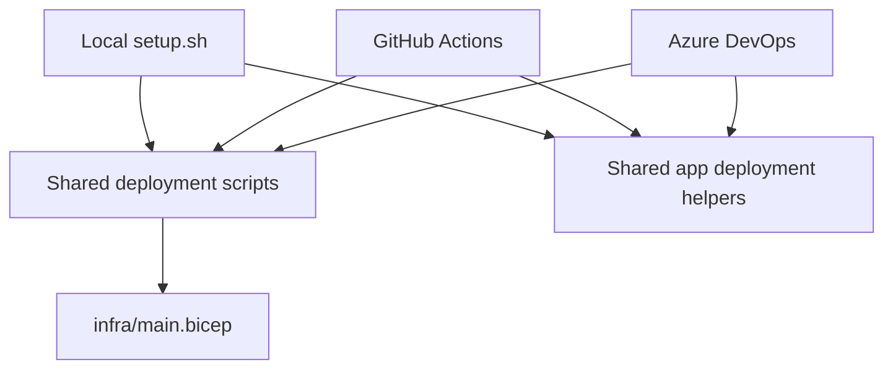

# CityOps deployment

CityOps is a reference architecture with three supported deployment experiences:

1. Local scripts.
2. GitHub Actions.
3. Azure DevOps.

All three use [`infra/main.bicep`](../../infra/main.bicep) as the single infrastructure source of truth and the shared scripts under [`scripts/`](../../scripts/). The CI providers remain responsible for authentication, triggers, approvals, concurrency, secrets, test reporting, and artifacts.

## Choose a deployment method

| Method                              | Use it when                                                                                 | Authentication                            | Configuration                    |
| ----------------------------------- | ------------------------------------------------------------------------------------------- | ----------------------------------------- | -------------------------------- |
| [Local scripts](local.md)           | Evaluating the architecture, bootstrapping, troubleshooting, or demonstrating without CI/CD | Interactive `az login`                    | Prompts or environment variables |
| [GitHub Actions](github-actions.md) ([step-by-step setup](github-actions-setup.md)) | Demonstrating GitHub-native CI/CD                                                           | Entra workload identity federation (OIDC) | GitHub variables and secrets     |
| [Azure DevOps](azure-devops.md)     | Demonstrating Azure DevOps CI/CD                                                            | ARM service connection                    | ADO variable groups              |

Only one CI provider should have deployment triggers enabled for a shared reference deployment. Validation may run in both, but do not apply through GitHub Actions and ADO simultaneously because their concurrency locks do not coordinate across platforms.

## Shared lifecycle

Every infrastructure option follows the same intended lifecycle:

1. Compile and validate Bicep.
2. Preview changes with Azure `what-if`.
3. Require an explicit or environment approval before apply.
4. Deploy `infra/main.bicep` at subscription scope.
5. Publish or retain deployment outputs.
6. Run infrastructure integration tests.

The app lifecycle is build and tests → migrate dev database → deploy dev slot → health check → explicit production migration and slot swap → production health check.

## Resources created

The Bicep template creates or updates one shared resource group containing:

- Linux App Service and a `dev` deployment slot.
- PostgreSQL Flexible Server with production and development databases.
- Key Vault and managed-identity role assignments.
- Azure OpenAI model deployment.
- Storage, Application Insights, Log Analytics, alerts, and Azure Policy resources.

Names are deterministic. With the default `cityops` base name, examples include `rg-cityops`, `app-cityops`, `kv-cityops`, `pg-cityops`, and `azopenai-cityops`.

## Before deploying

Read [configuration.md](configuration.md), especially the stable-secret requirements. Then follow exactly one method guide. Operational procedures are in [runbook.md](runbook.md).

The older consolidated [deployment guidelines](../deployment-guidelines.md) remain the deep technical reference for architecture, policy, tests, and troubleshooting.
