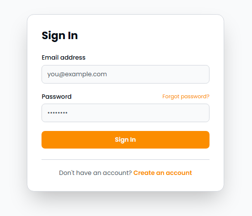
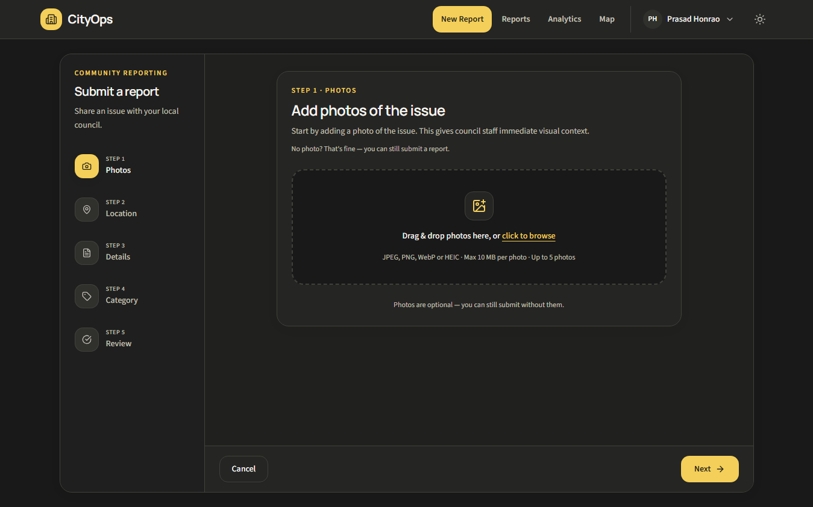
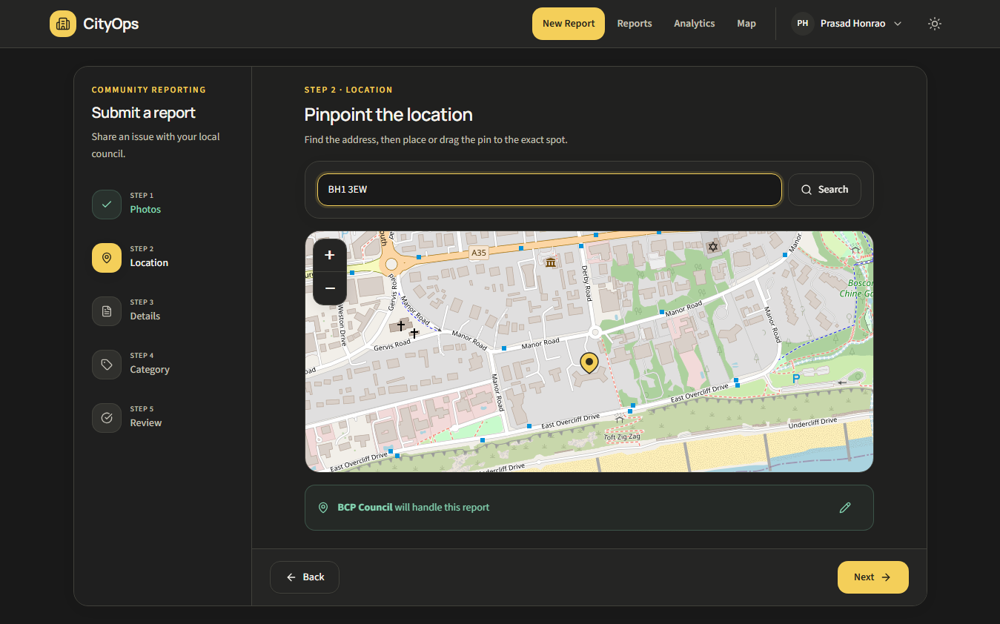
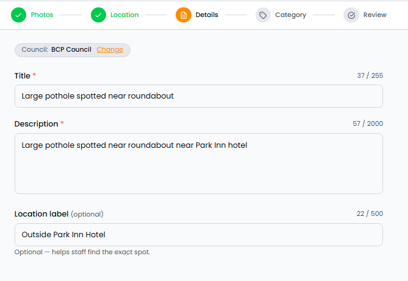
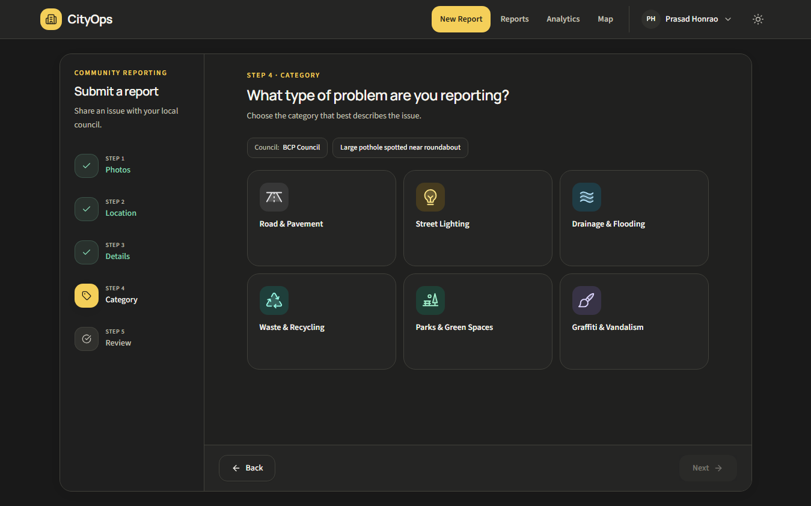
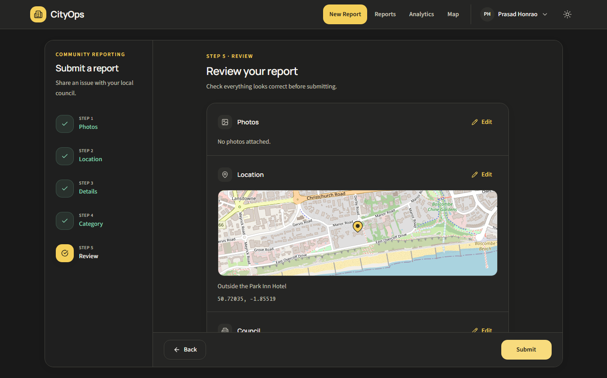
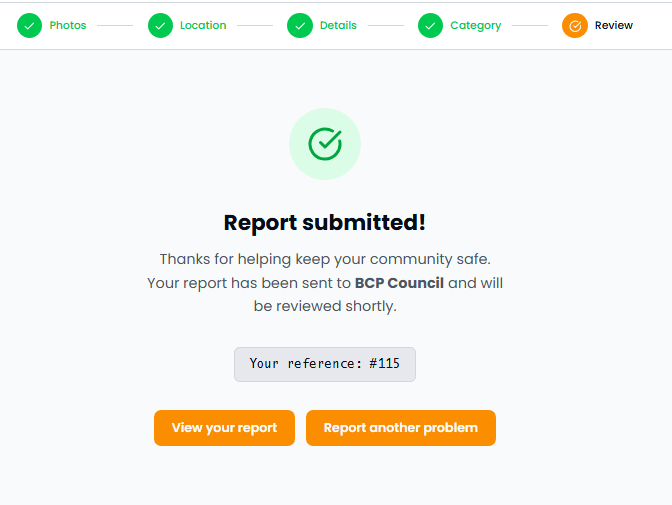
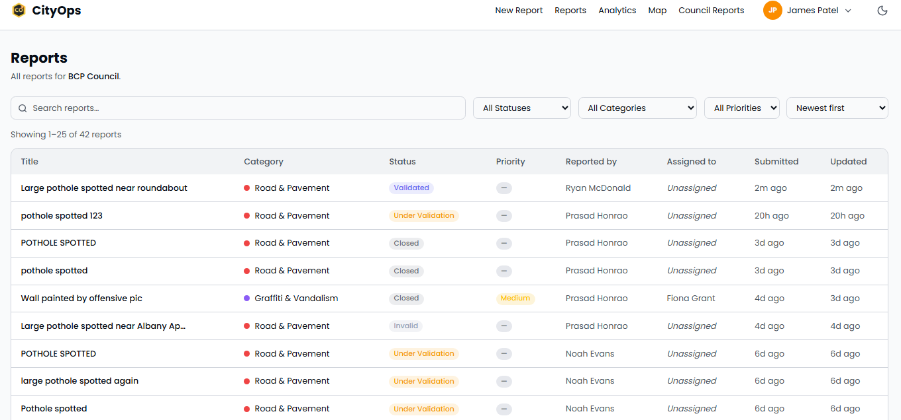
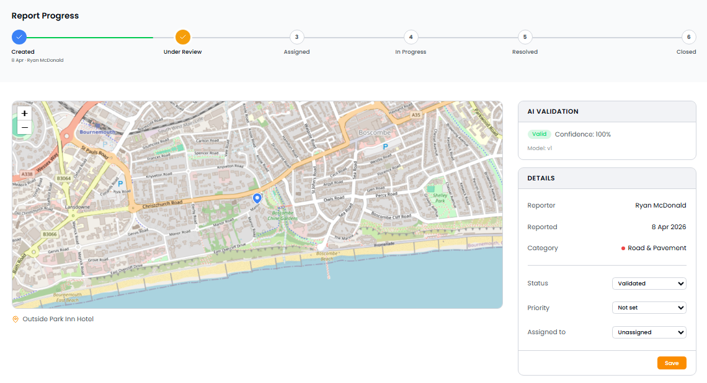

# Project Walkthrough

Before writing a single line of code (or prompting Copilot), get to know the project you'll be working with. This module gives you a tour of CityOps — what it is, how it's built, and what each role experiences — so every subsequent exercise is grounded in real context.

## The Project: CityOps

**CityOps** is a national civic reporting and city operations platform. Citizens report public issues anywhere in the UK, and the responsible council is automatically detected from the pin location.

### Tech Stack

| Layer        | Technology                    |
| ------------ | ----------------------------- |
| Frontend     | Next.js 16 / React 19         |
| Styling      | Tailwind CSS v4 + ShadCN UI   |
| Database     | PostgreSQL + PostGIS (Docker) |
| ORM          | Prisma                        |
| Auth         | Auth.js (NextAuth v5)         |
| AI           | Azure OpenAI (gpt-4o vision)  |
| Email        | Mailpit (local)               |
| File Storage | Local filesystem              |
| CI/CD        | GitHub Actions                |

> The app runs entirely on your local machine or inside a GitHub Codespace. There are no external cloud storage dependencies — uploaded files are stored on the local filesystem.

### Key Architectural Concepts

- **Multi-tenancy** — Every council is a separate tenant. Staff only see their council's data. All queries in staff context must include a `tenant_id` clause.
- **RBAC** — Four roles: Citizen, Authority User, Tenant Admin, Platform Admin. Enforced in middleware and at the query layer.
- **Report lifecycle** — `Created → Under Validation → Validated → Assigned → In Progress → Resolved → Closed`
- **AI validation** — Uploaded images are checked for relevance by Azure OpenAI gpt-4o. Results are auditable and overridable.
- **Geospatial tenant detection** — When a citizen drops a pin, PostGIS `ST_Within` determines the responsible council from boundary data.

---

## What You'll Do

1. Register as a new citizen and verify your email address via Mailpit
2. Submit a public issue report
3. Log in as a council staff member and walk the report through its full lifecycle
4. Observe how AI validation, tenant isolation, and RBAC shape what each user sees

## Prerequisites

- CityOps is running at [http://localhost:3000](http://localhost:3000) (see Module 00)
- Mailpit is running at [http://localhost:8025](http://localhost:8025)
- The database has been seeded (`npm run db:seed`)

---

## Part 1 — Register as a Citizen

1. Open [http://localhost:3000](http://localhost:3000) and click **Sign In** in the top navigation
2. On the Sign In page, click **Create an account**

   

3. Fill in your name, email address, and a password, then submit
4. Open Mailpit at [http://localhost:8025](http://localhost:8025) — you should see a **Verify your email** message
5. Click the verification link inside the email
6. You are redirected back to the app and your account is now active

> [!NOTE]
> All emails (registration, password reset, and status change notifications) are captured by Mailpit in local development — nothing leaves your machine.

---

## Part 2 — Submit a Report

Once signed in, click **New Report** in the navigation (or go to `/reports/new`). The report wizard guides you through 5 steps.

### Step 1 — Photos

Optionally attach one or more photos of the issue. Photos give council staff immediate visual context.

- Drag and drop or click to browse — JPEG, PNG, WebP or HEIC, up to 10 MB each, up to 5 photos
- Photos are optional — click **Next** to skip if you don't have one

### Step 2 — Location

Enter a postcode or address in the search box and drop the pin on the map to mark the exact location of the issue.

- Type a postcode (e.g. `BH1 3EW`) and click **Search** — the map will centre on that location
- Drag the pin to fine-tune the position
- Once the pin is placed, the responsible council is detected automatically from the boundary data and confirmed in a banner beneath the map — **notice this happens without any manual selection**

> [!NOTE]
> This is PostGIS `ST_Within` in action. The app queries which council boundary polygon contains the pin's coordinates and assigns the report automatically.

### Step 3 — Details

Enter a title, description, and an optional location label to help staff find the exact spot.

- **Title** (required) — short summary of the issue, e.g. _Large pothole spotted near roundabout_
- **Description** (required) — more detail about the problem
- **Location label** (optional) — a landmark or address to help staff on the ground

### Step 4 — Category

Select the type of problem you are reporting.

Available categories: Road & Pavement, Street Lighting, Drainage & Flooding, Waste & Recycling, Parks & Green Spaces, Graffiti & Vandalism.

### Step 5 — Review & Submit

Review everything before submitting. Each section has an **Edit** link if you need to go back and change something.

Click **Submit** when you are satisfied. You will see a confirmation screen with a reference number.

> [!NOTE]
> If Azure OpenAI is configured, the uploaded image is validated automatically in the background. The AI result (valid/invalid/skipped) is visible to staff on the report detail page. If Azure OpenAI is not configured the step is skipped gracefully.

Click **View your report** to see the report detail page — observe the status badge showing **Created**.

---

## Part 3 — Staff Review

The seed data includes pre-created staff accounts for each council. Use them to explore the staff side.

### 3a — Sign In as Authority User

1. Sign out of your citizen account
2. Sign in with a seeded staff account. Full credentials for all tenants are listed in [`prisma/seed/README.md`](../../../../prisma/seed/README.md). For a quick start, use one of these BCP Council accounts:

   | Email                                 | Password       | Role           |
   | ------------------------------------- | -------------- | -------------- |
   | `james.patel@bournemouth.cityops.dev` | `Password123!` | Authority User |
   | `fiona.grant@bournemouth.cityops.dev` | `Password123!` | Tenant Admin   |

3. You are redirected to the **Reports** list at `/staff/reports`
4. Note the subheading says **Manage reports for BCP Council** — you only see reports belonging to your council. This is tenant isolation in action.

   

### 3b — Walk the Report Lifecycle

Click on the report you just submitted (or any report in the list) to open the report detail. On the right panel you can update the **Status**, **Priority**, and **Assigned to** fields.

Progress the report through the full lifecycle:

| Step | Status transition                | Action                                |
| ---- | -------------------------------- | ------------------------------------- |
| 1    | `created` → `under_validation`   | Change status to **Under Validation** |
| 2    | `under_validation` → `validated` | Change status to **Validated**        |
| 3    | `validated` → `assigned`         | Assign to a staff member and save     |
| 4    | `assigned` → `in_progress`       | Change status to **In Progress**      |
| 5    | `in_progress` → `resolved`       | Change status to **Resolved**         |
| 6    | `resolved` → `closed`            | Change status to **Closed**           |

Click **Save** after each change.

> [!TIP]
> After each status change, switch back to your citizen account and check **My Reports** — you will see a status-change email arrive in Mailpit and the badge update in the UI.

---

## Part 4 — Explore the Map

1. Navigate to the public map at `/map`
2. Zoom in and out — reports are clustered and colour-coded by category
3. Click a cluster or pin to see the report summary

---

## What You Just Saw

| Concept                     | Where you saw it                        |
| --------------------------- | --------------------------------------- |
| Email verification flow     | Mailpit + registration                  |
| Geospatial tenant detection | Pin → council auto-assignment           |
| AI image validation         | Report submission (if Azure OpenAI set) |
| RBAC — citizen vs. staff    | Different views for each role           |
| Tenant isolation            | Staff only see their council's reports  |
| Report lifecycle            | 7-stage status progression              |
| Real-time notifications     | Status change emails in Mailpit         |

In the next module you will configure Copilot custom instructions so it understands all of this context automatically.
