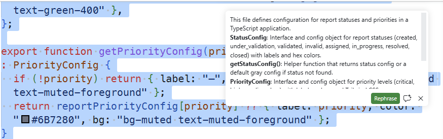

# Inline Chat

> **Tool**: GitHub Copilot — Inline Chat in VS Code | **Time**: 20 min

## Scenario

In the previous module you used Ask Mode to explore CityOps — questions only, no edits. Now you'll make real changes using **Inline Chat**.

Inline Chat (Ctrl+I) opens a prompt directly inside the editor, right at your cursor or selection. Unlike the Chat panel, you never leave the file you're working in — Copilot reads the code around your selection and applies changes in place.

## Prerequisites

- CityOps repository open in VS Code
- GitHub Copilot extension installed and signed in
- Familiarity with the codebase from the previous module

---

## Exercise 1 — Explain a Function In-Place

Inline Chat has a `/explain` command that gives you an explanation of selected code without switching away from the file.

1. Open `src/components/reports/ReportComments.tsx`
2. Select the `formatRelativeTime` function (lines 6–17)
3. Press **Ctrl+I** to open Inline Chat
4. Type:

   ```text
   /explain
   ```

5. Read the explanation inline — Copilot walks through each time threshold without you having to trace the logic yourself

   

6. Press **Escape** to dismiss without making any changes

> [!TIP]
> The Inline Chat slash commands are `/explain`, `/fix`, and `/tests`. For anything else use a short natural-language instruction instead.

---

## Exercise 2 — Add a JSDoc Comment

1. Stay in `src/components/reports/ReportComments.tsx`
2. Select the `formatRelativeTime` function again
3. Press **Ctrl+I** and type:

   ```text
   Add a JSDoc comment
   ```

4. Review the generated comment — it should describe what the function does and document the `date` parameter
5. Accept with **Accept**

---

## Exercise 3 — Add More Report Categories

`prisma/seed.ts` has a `CATEGORIES` array that controls which report categories get seeded into the database. Currently it has 6 categories. You'll use Inline Chat to add more — the same technique as extending any in-memory data structure.

1. Open `prisma/seed.ts`
2. Find the `CATEGORIES` array (around line 262) and select the entire array — click and drag from the opening `[` to the closing `]`
3. Press **Ctrl+I** to open Inline Chat
4. Type:

   ```text
   Add 3 more categories following the same pattern. Use relevant UK civic issue types that aren't already listed, with appropriate emoji icons and hex colors.
   ```

5. Review the suggested entries:
   - Do they follow the same `{ name, slug, icon, color }` shape?
   - Are the slugs kebab-case?
   - Do the colors look distinct from the existing six?
6. Accept with **Accept**

> [!TIP]
> Selecting the whole array gives Copilot the full context of the existing entries — it sees the pattern and matches it automatically. This is the core technique for Inline Chat: **select what you want to extend, then describe what to add**.

---

## Exercise 4 — Fix Accessibility

`ReportComments.tsx` renders a decorative `<MessageCircle>` icon in the heading but it has no `aria-hidden` attribute — screen readers will try to announce it.

1. Open `src/components/reports/ReportComments.tsx`
2. Select the `<MessageCircle>` line inside the `<h2>` heading
3. Press **Ctrl+I** and type:

   ```text
   This icon is decorative. Add aria-hidden="true"
   ```

4. Review — Copilot should add `aria-hidden="true"` to the icon and nothing else
5. Accept with **Accept**

> [!TIP]
> Small, focused selections with short instructions are where Inline Chat is most reliable. The smaller the selection, the more precise the output.

---

## Key Techniques

| Technique                            | Why it works                                          |
| ------------------------------------ | ----------------------------------------------------- |
| Select the block, then Ctrl+I        | Copilot uses your selection as context for the edit   |
| `/explain` before editing            | Understand the code before changing it                |
| Short, specific instructions         | One change per prompt produces reliable results       |
| Select the whole structure to extend | Copilot sees the pattern and matches it automatically |

---

## Summary

You've used Inline Chat to explain a function, document it, extend a data structure, and fix an accessibility issue — all without leaving the editor.

- **Select precisely** — the selection is Copilot's primary context
- **Keep prompts short** — one instruction at a time works better than multiple at once
- **Slash commands**: `/explain`, `/fix`, `/tests` — everything else is natural language

In the next module you'll move to **Plan Mode** — where Copilot designs a full implementation plan before writing any code.
